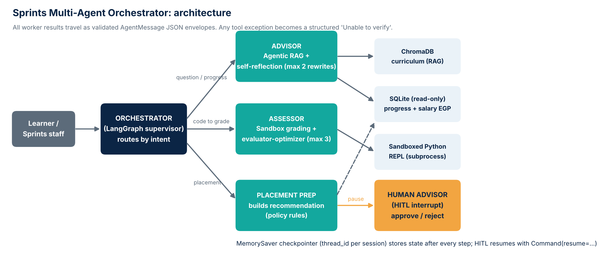

# Sprints Multi-Agent AI Career & Assessment Orchestrator

A stateful **LangGraph** system with an orchestrator and two worker agents. It answers curriculum questions (agentic RAG on ChromaDB), reports learner progress and target salary in EGP (read-only SQLite), grades Python submissions in a sandbox with an evaluator-optimizer loop (max 3 refinements), and escalates every placement decision to a human (HITL).



## Quick start
```bash
python -m venv .venv && source .venv/bin/activate      # Windows: .venv\Scripts\activate
pip install -r requirements.txt
cp .env.example .env                                   # then put your GOOGLE_API_KEY in .env
python -m src.main demo                                # live Gemini (GEMINI_MODEL=gemini-3.5-flash-lite)
python -m src.main demo --offline --auto-approve       # no key or internet needed
python -m src.main chat                                # interactive; you act as the human advisor
python -m pytest tests -q                              # 44 tests (offline)
jupyter notebook notebooks/evaluator_optimizer_loop.ipynb
```
With no `GOOGLE_API_KEY`, the system automatically uses a deterministic offline stand-in so everything still runs.

## How it maps to the acceptance criteria
| Criterion | Where | Evidence |
|---|---|---|
| LangGraph for all orchestration | `src/agents/orchestrator.py`, sub-graphs in `advisor_agent.py` and `assessor_agent.py` | conditional edges route by intent |
| Docstrings mapped to curriculum | every module, class, function, tool | each docstring names the Sprints module |
| ChromaDB under 1000 ms | `src/tools/rag_retriever.py` | `tests/test_tools.py::test_retrieval_p95_latency_under_1000ms`, notebook section 5, 600 ms embedding timeout + fallback |
| Graceful `Unable to verify` | `db_queries.py`, `code_repl.py`, `rag_retriever.py` | `test_missing_database_returns_unable_to_verify`, `test_repl_infrastructure_failure_returns_unable_to_verify` |
| Loop halts at 3 refinements | `assessor_agent.py::_after_eval` | `test_loop_halts_after_exactly_three_refinements` |
| Human approves placements | `orchestrator.py::human_review_node` | `test_placement_always_pauses_for_human_and_resumes` |

## Repository map
```
data/            sprints_learner_db.csv, sprints_learner.db (SQLite), curriculum_docs/ (RAG source), chroma_db/ (built on first run)
src/state.py     global TypedDict state + Pydantic schemas (AgentMessage, GradeReport, ...)
src/llm.py       Gemini facade + offline stand-in
src/agents/      orchestrator.py, advisor_agent.py, assessor_agent.py
src/tools/       rag_retriever.py, code_repl.py, db_queries.py
src/main.py      CLI demo and chat
notebooks/       evaluator_optimizer_loop.ipynb (executed)
docs/            technical_report.pdf, final_presentation.pdf/.pptx, project_charter.md/.pdf, CHANGELOG.md, demo_walkthrough.mp4, demo_script.md
scripts/         build_report.py, build_deck.js, make_diagrams.py, make_demo_video.py (regenerate docs)
tests/           44 pytest tests
```

## Honest notes
- The discovery call audio could not be transcribed while building; see `docs/project_charter.md` (assumptions).
- The supplied CSV has 25 learners (the deck says 500). Curriculum documents are authored stand-ins.
- Saved notebook outputs, test results and the demo video were produced in **offline mode**. Run the demo and notebook with your key to record live Gemini latency and behaviour.
